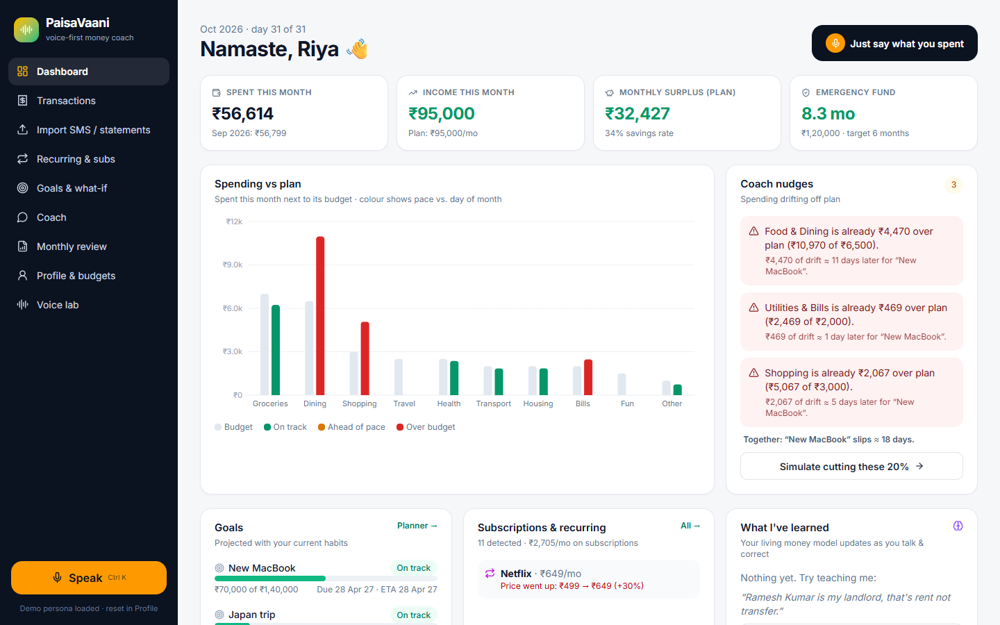
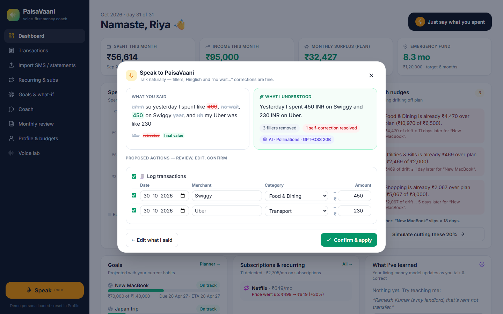
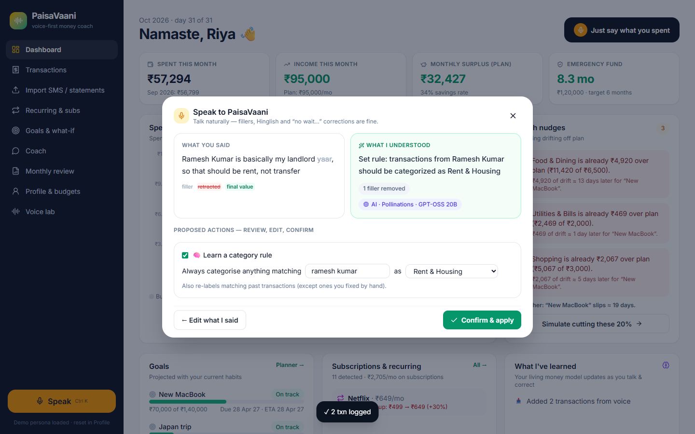
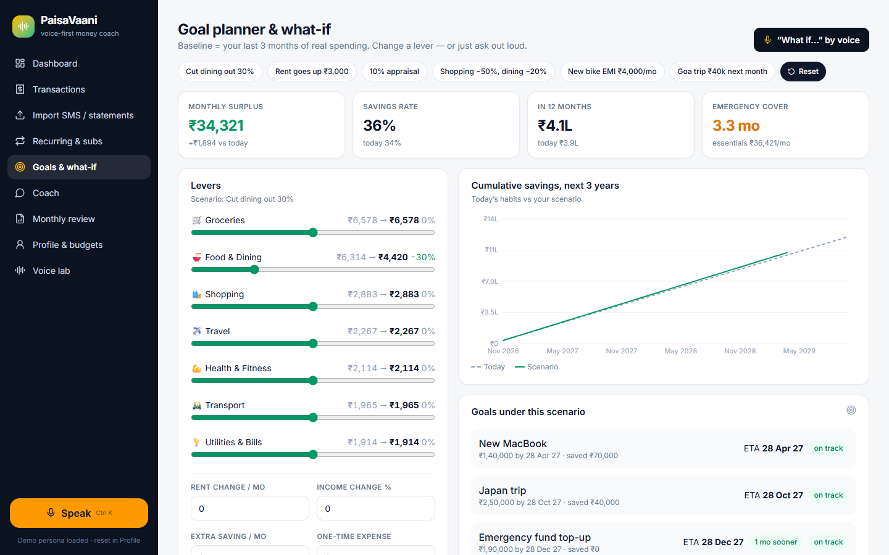
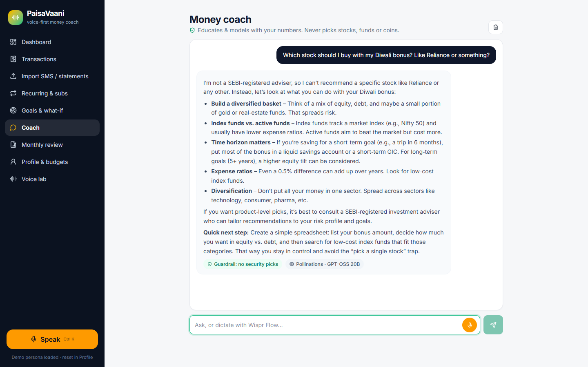
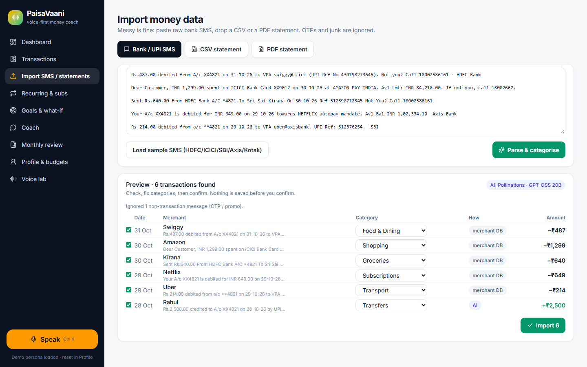
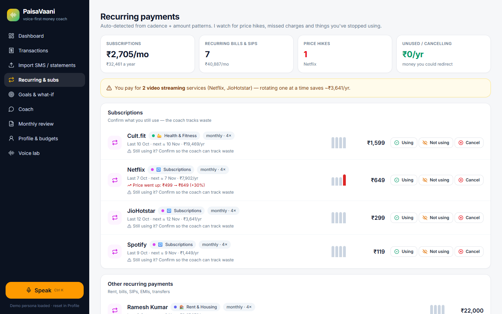
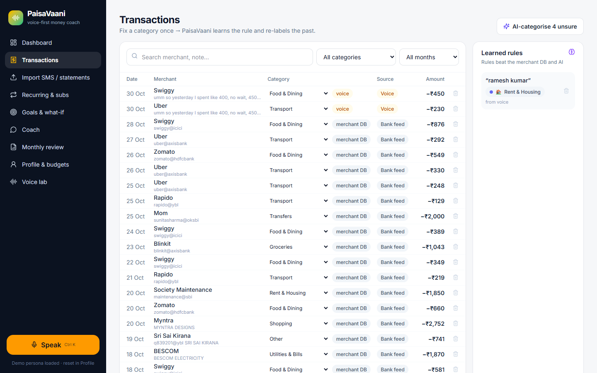
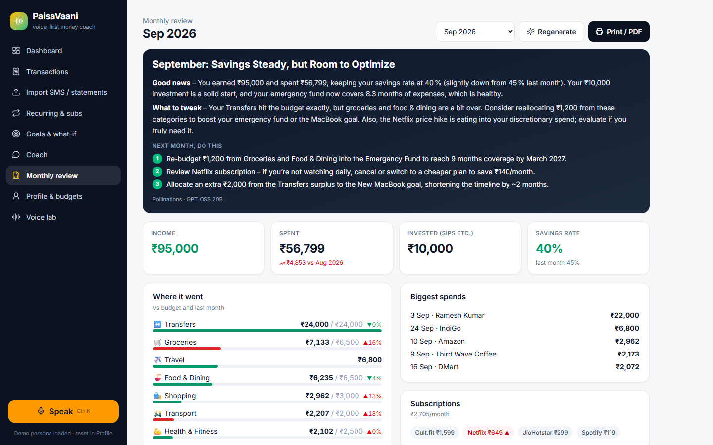

# 🎙️ PaisaVaani — the money coach you just *talk* to

> **Problem 04 · Personal Finance Coach with a Living Money Model**
> Product Space × Wispr Flow Agentic AI Hackathon (31 Oct 2026)

Most budgeting apps make you fill forms and then stop at "you spent ₹X on food". PaisaVaani ("money-voice") works the way Indians actually deal with money. You say it messily ("umm spent like 400, no wait, 450 on Swiggy yaar"), forward your bank SMS, or drop a statement PDF. A **living money model** then learns from your corrections, catches subscription creep, nudges you when you drift, and replays your goals under any *what-if* you ask about out loud.

**Live demo:** _<add Vercel URL>_ · **Demo video (82s, captioned):** [docs/paisavaani-demo.mp4](docs/paisavaani-demo.mp4)



| Messy speech → "400, no wait, 450" resolved | Teach a rule by voice |
|---|---|
|  |  |
| **What-if: cut dining 30%** | **Guardrail: no stock tips** |
|  |  |
| **Bank SMS import (OTP ignored)** | **Subscriptions & price hikes** |
|  |  |
| **Learned rules + correction loop** | **AI monthly review** |
|  |  |

---

## Why this matters
- India runs on UPI. One person can get 60+ debit SMS a month from 4 banks, with cryptic narrations (`UPI/430155/RAMESH KUMAR/rameshkumar@okhdfc`).
- Categorisation is where every app breaks. Your landlord looks like a "transfer", and Zepto bills as "Kiranakart Technologies". Users fix it once and the app forgets.
- Nobody types expenses. Talking is roughly 3× faster than typing, but real speech is full of fillers and self-corrections, so naive speech-to-text logs the wrong number.

## What it does (mapped to the brief)

| Brief requirement | How PaisaVaani does it |
|---|---|
| **Natural speech is the main input** | Global **Speak** button (Ctrl K) on every screen. Use Wispr Flow or the built-in en-IN mic. The LLM strips fillers (*umm, like, yaar, matlab*) and resolves self-corrections (the last stated value wins). The UI **shows its work**: fillers struck through, retracted values in red, final values in green. Then it proposes typed actions you can edit. |
| Ingest messy statements: **PDF, CSV, SMS** | SMS parser covers HDFC/ICICI/SBI/Axis/Kotak formats (UPI VPA, card POS, NEFT, autopay) and ignores OTP/promo messages. CSV auto-detects column layouts. PDF text is extracted in the browser; when the layout is too messy, the LLM extracts the rows. Duplicates are skipped. |
| Auto-categorisation | A 4-layer cascade: **learned rules → merchant DB → LLM → "unsure"**. Each transaction shows *how* it was categorised. |
| **Correction loop that learns rules** | Change a category once and you get *"Always file 'ramesh kumar' under Rent? It will also fix 3 past transactions"*. Or just say *"Ramesh Kumar is my landlord, that's rent not transfer."* Rules beat every other layer, and manual fixes are never overwritten. |
| Recurring payments & subscriptions | Detected from cadence (weekly/monthly/quarterly/yearly) plus amount stability. Alerts for **price hikes** (Netflix ₹499 → ₹649, +30%), **missed charges**, **unused** subscriptions (say *"I'm not using cult.fit anymore"*) and **overlapping OTT** services. |
| Persistent financial profile | Income, fixed costs, emergency fund and goals with target dates. You can set them by voice (*"I earn about 95k in hand, rent is 22k…"*). Saved locally, and every AI call reasons over it. |
| Goal planner + **what-if simulation** | Baseline comes from your last 3 months of real spending; SIPs are treated as committed money. Goals are funded earliest-deadline first. Sliders, presets, or ask by voice: *"what if I cut dining out by 30% and rent goes up 3k?"* You get the savings curve, ETA per goal, and "2 months sooner / later". |
| Nudges when spending drifts | Pace-aware: spend-to-date is compared against the budget × how far through the month you are. Each nudge is framed by its goal impact (*"₹4,920 of drift ≈ 13 days later for New MacBook"*), plus the combined slip across all drifting categories, with one-tap "simulate fixing this". |
| Monthly review report | Stats, category vs budget vs last month, biggest spends, subscriptions and goals. An LLM writes a headline, a narrative and 3 concrete actions. Printable to PDF. |
| **Guardrails: no specific securities** | Three layers: (1) a system-prompt rule, (2) intent detection on the question (*"which stock should I buy"*), (3) an output filter that blocks named stocks, funds or coins next to buy-language. The coach then *educates* (emergency fund first, asset classes by time horizon, expense ratios), suggests a SEBI-registered adviser, and offers to model the scenario. |
| Confirmation before acting | Nothing from voice or imports is saved until you review and confirm. Every action is editable. |

## The voice pipeline
```
Wispr Flow / mic ──► raw speech ──► ① strip fillers ──► ② resolve self-corrections ──► ③ LLM → typed actions
                                                                                         │
     log_transactions · set_rule · update_profile · add_goal · what_if · subscription · ask_coach
                                                                                         ▼
                                          ④ show heard-vs-understood + editable cards ──► ⑤ confirm ──► money model updates
```
A single utterance can carry several intents, for example *"spent 450 on Swiggy, and Ramesh is my rent"* → log a transaction **and** learn a rule.

## AI architecture
- `api/ai.js` is a serverless **task router** (`voice`, `categorize`, `statement`, `coach`, `report`) with strict JSON contracts and a **provider chain**: Groq (Llama 3.3 70B) → Google Gemini 2.5 Flash → keyless open model (GPT-OSS 20B). Keys stay on the server.
- **Graceful degradation:** every AI feature has a deterministic local fallback (a rule-based speech parser that handles "no wait" corrections and Indian number words like *k, lakh, crore*, plus a template coach and report). The demo never dead-ends.
- **Context engineering:** the coach gets a compact *living money model* summary (averages, surplus, goals with ETAs, recurring payments, nudges, learned rules), not raw transactions. That's cheaper, more private and more grounded.
- **Privacy:** all data stays in the browser (localStorage). AI calls send only the text being parsed and a numeric summary. You can export your money model as JSON.

## Run it
```bash
npm install
npm run dev            # http://localhost:5173 (serverless route is mounted in dev too)
# optional, for faster/stronger AI:
#   GEMINI_API_KEY=...  or  GROQ_API_KEY=...   (in .env.local / Vercel env)
```
A demo persona (Riya, Bengaluru, 3 months of realistic UPI data) loads on first visit. Use **Profile → Start fresh** to use your own data. A sample messy PDF statement is at `/sample-statement.pdf`, and sample SMS/CSV are one click away on the Import page.

## 2-minute demo script
1. **Dashboard:** dining is ₹4.9k over plan; nudges show each category's goal impact (MacBook slips ≈ 19 days in total). Netflix price hike is flagged.
2. **Speak:** *"Umm so yesterday I spent like 400, no wait, 450 on Swiggy, and uh my Uber was like 230."* Watch fillers and the correction get resolved, then confirm.
3. **Teach:** *"Ramesh Kumar is basically my landlord yaar, so that should be rent, not transfer."* 4 past transactions are re-labelled and the emergency-fund cover recalculates.
4. **Import:** paste sample SMS (the OTP is ignored, Netflix autopay is caught), then drop the PDF statement.
5. **What-if:** *"What if I cut dining out by 30 percent and my rent goes up by 3k?"* See the goal ETAs move.
6. **Coach:** *"Which stock should I buy with my Diwali bonus?"* → guardrail badge, education, and an offer to model it.
7. **Monthly review:** AI narrative + 3 actions → Print.

## Built with voice (Wispr Flow)
_<Fill in honestly: which prompts/specs/fixes you dictated with Wispr Flow, plus a screenshot or clip. Judges score this at 20%.>_

## Stack
React 18 + Vite, Tailwind v4, Recharts, pdf.js, PapaParse, Vercel serverless functions. No database: the money model lives on your device.

> PaisaVaani is an educational tool, not investment advice. It never recommends specific securities.
